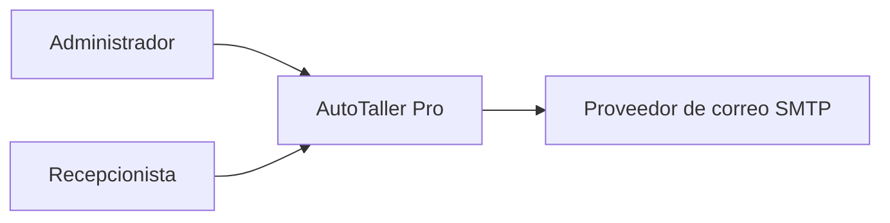
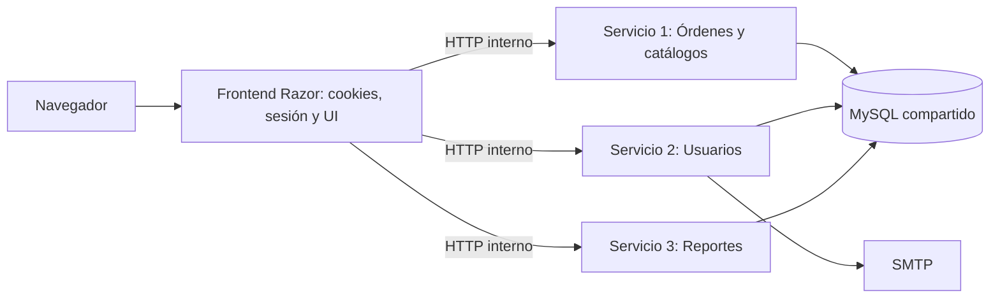
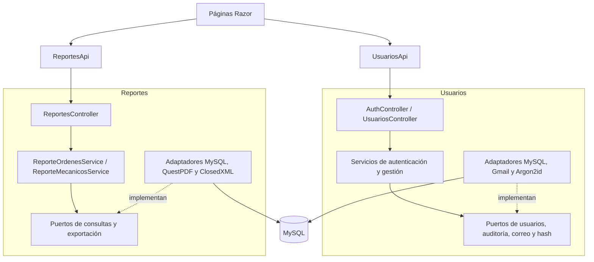
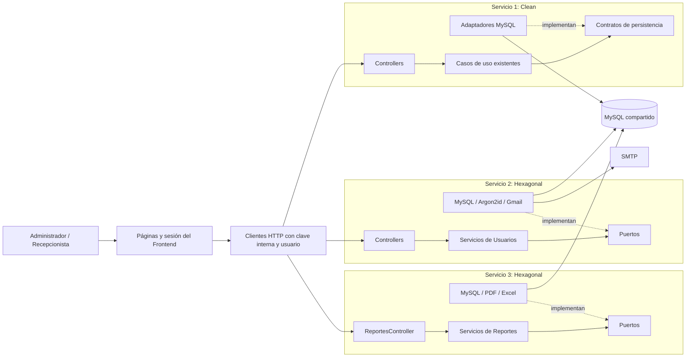
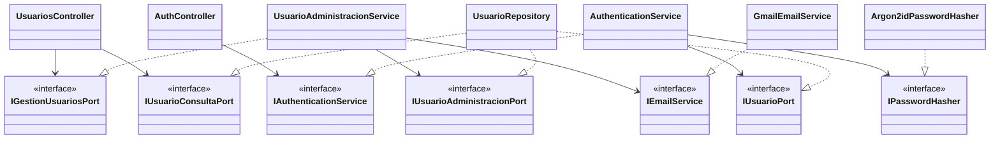

# Usuarios y Reportes: material para la entrega SBA

Proyecto: AutoTaller Pro / TallerMecanico. Fecha: 06/11/2026.
Grupo 2: Ariel, Alda y Alex, según el plan del equipo.

Este material reúne la parte de Usuarios, Reportes e integración para incorporarla
al documento grupal. Los resultados reproducibles están en
[Validación SBA](VALIDACION_SBA.md), y la matriz en
[Cumplimiento de la rúbrica](CUMPLIMIENTO_RUBRICA.md).

## Contexto y objetivo

El taller necesita controlar quién utiliza el sistema, las operaciones realizadas
y la información de sus órdenes. El Administrador gestiona cuentas y consulta
reportes; el Recepcionista utiliza las funciones operativas autorizadas.

La entrega separa el producto en un Frontend y tres servicios. SBA define estos
límites de ejecución. Dentro de Usuarios y Reportes se aplica arquitectura
hexagonal: la lógica depende de puertos, y los adaptadores resuelven HTTP, MySQL,
correo, contraseñas y generación de documentos. Órdenes conserva Clean Architecture.

## Requisitos de Usuarios y Reportes

- Login con sesión y menú por rol; revocación al desactivar la cuenta o cambiar
  su rol, y cierre de sesión incluso si el backend no está disponible.
- Listado de usuarios sin contraseñas ni hashes, filtros y paginación.
- Invitación con nombre generado, correo y activación con token de un solo uso.
- Edición, baja lógica y reactivación, con protección de la cuenta propia y del
  último Administrador activo.
- Cambio de contraseña con la actual y dos veces la nueva; cierre de sesión
  después del cambio.
- Auditoría de accesos y operaciones con usuario y fecha.
- Reporte de órdenes con fechas y estado, y reporte sumariado por mecánico con
  nombre y fechas. Ambos incluyen PDF y Excel; el segundo incorpora gráfico.

## C4: nivel 1, contexto

## C4: nivel 2, aplicaciones

Cada aplicación tiene proyecto, proceso e imagen propios. Solo el Frontend
publica puertos. Kestrel termina HTTPS y las APIs comparten una clave interna.
Órdenes es el único responsable de preparar el esquema. La base compartida es una
decisión SBA del equipo; no se plantea aislamiento de datos por microservicio.

## C4: nivel 3, componentes del grupo 2

## C4: vista combinada de niveles 1 a 3

## Clases y puertos de Usuarios

`AuthController` recibe `IAuthenticationService`; la implementación registrada es
`AuthenticationService`. La cookie se crea en el Frontend, después de recibir
`UsuarioSesionDto`. Los DTO nunca contienen el hash ni el token de invitación.

## Patrones de diseño localizables

| Patrón | Ejemplo del código | Propósito |
|---|---|---|
| Repository | `servicio-usuarios/Infraestructura/Persistencia/MySql/UsuarioRepository.cs` | Aísla SQL detrás de los puertos de usuarios. |
| Adapter | `servicio-reportes/Infraestructura/Documentos/QuestPdfReporteOrdenesAdapter.cs` y adaptadores ClosedXML | Implementa los puertos de generación con bibliotecas concretas. |
| Facade | `servicio-usuarios/Aplicacion/Fachadas/RegistroFacade.cs` | Coordina el flujo de solicitud de registro mediante una entrada común. El registro público de la UI sigue retirado. |
| Singleton | `frontend-app/Aplicacion/Configuracion/ConfiguracionTaller.cs` | Proporciona la configuración visual del taller usada por las vistas. |

En Servicio 1 se conservan además Factory Method y Unit of Work. No se
reescribieron sus reglas de transacción para realizar esta integración.

## SOLID aplicado

| Principio | Evidencia | Justificación |
|---|---|---|
| Responsabilidad única | Servicios de Reportes y sus adaptadores de consulta/documentos | Consultar SQL y dibujar un PDF son responsabilidades distintas. |
| Abierto/cerrado | Puertos `IGeneradorReporte*PdfPort` e `IGeneradorReporte*ExcelPort` | Una nueva implementación puede registrarse sin cambiar la orquestación del reporte. |
| Sustitución de Liskov | Puertos de usuarios y dobles usados en `servicio-usuarios.Tests` | Los mismos servicios operan con adaptadores reales o dobles que respetan su contrato. |
| Segregación de interfaces | `IUsuarioConsultaPort` e `IUsuarioAdministracionPort` | Las consultas y las operaciones de administración tienen contratos específicos. |
| Inversión de dependencias | Constructor de `UsuarioAdministracionService` | La aplicación depende de puertos; MySQL, correo y hash quedan en Infraestructura. |

## Recorridos y evidencia visual

Las capturas se generan con cuentas y datos ficticios durante el recorrido
automatizado; no contienen la configuración privada de Aiven o SMTP.

| Evidencia | Archivo |
|---|---|
| Confirmación de operación sobre un usuario | [Confirmación](evidencias/sba/confirmacion-usuario.png) |
| Formulario de invitación y validaciones | [Crear usuario](evidencias/sba/crear-usuario.png) |
| Cambio de contraseña | [Contraseña](evidencias/sba/cambiar-contrasena.png) |
| Reporte de órdenes y estados | [Órdenes](evidencias/sba/estados-ordenes.png) |
| Filtros y gráfico del reporte por mecánico | [Mecánicos](evidencias/sba/filtro-mecanicos.png) |

Los resultados de las 974 pruebas y del arranque Docker se distinguen de las
comprobaciones manuales pendientes en [Validación SBA](VALIDACION_SBA.md).

## Organización y defensa

`frontend-app` contiene presentación y clientes HTTP. `backend-services` contiene
las tres implementaciones independientes. `shared` contiene los DTO y `tests`
agrupa cuatro suites con soporte común. Los lanzadores Windows/macOS construyen
las cuatro imágenes y ejecutan la administración de cuentas en Usuarios.

Para la defensa conviene demostrar un login por rol, una invitación y activación,
un cambio de contraseña, una baja con auditoría y ambos reportes filtrados con
sus exportaciones. Explicar dónde cambian los datos entre UI, DTO, puerto y
adaptador, y por qué el Frontend no conoce MySQL.

La principal dificultad de la migración fue trasladar lógica y pruebas sin
cambiar la experiencia de uso. Separar el proceso HTTP de las reglas existentes
permitió conservar los flujos y comprobar cada frontera por separado. Como
mejora se contempla HTTPS interno; el plan actual utiliza HTTP dentro de la red
privada de Compose.

## Referencias de la implementación

- [Plan del entregable](PLAN_ENTREGABLE_3_SBA.md), como antecedente histórico.
- [Arquitectura SBA](SBA.md), con la configuración final de despliegue.
- [Arquitectura hexagonal](ARQUITECTURA_HEXAGONAL.md).
- [Clean Architecture](ARQUITECTURA_CLEAN.md).
- [CI y reproducción de las pruebas](CI.md).
- [README y preparación del entorno](../README.md).
