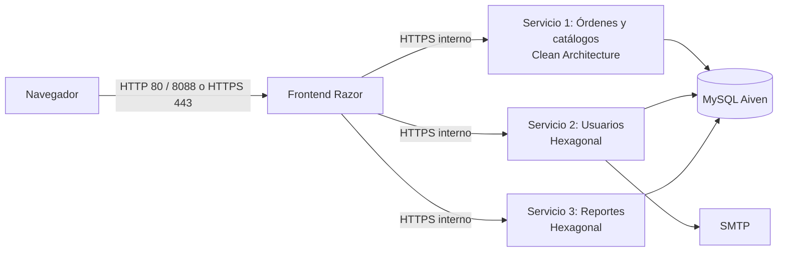

# Arquitectura SBA y despliegue de cuatro aplicaciones

La solución integra un Frontend Razor y tres APIs ASP.NET Core .NET 10. Cada
aplicación tiene su proyecto, proceso e imagen Docker; todas comparten solamente
`shared/TallerMecanico.Contratos` y las tres APIs usan la misma base MySQL de Aiven.



Los diagramas C4, de clases y de secuencia están como código PlantUML en
[`docs/diagramas/`](diagramas/).

## Responsabilidades y límites

- **Frontend:** `Pages/`, clientes HTTP en `Api/`, borradores y token en `Sesion/`, y
  cookie y usuario activo en `Seguridad/`. No tiene capas de negocio ni recibe la
  cadena MySQL o las credenciales del correo.
- **Órdenes:** catálogos, dashboard, consultas y transacciones de órdenes. Es el
  único servicio que crea o actualiza el esquema al arrancar.
- **Usuarios:** credenciales, estado de cuentas, invitaciones, activación, cambio
  de contraseña, correo y bitácora de accesos. Aloja los comandos de consola.
- **Reportes:** consultas agregadas, filtros, gráficos y exportaciones PDF/XLSX.
- **Contratos:** DTO de solicitud y respuesta, y las reglas que el Frontend y un
  servicio deben aplicar igual (`ReglasVehiculo`, `ReglasCuenta`).

Órdenes usa Clean Architecture; Usuarios y Reportes usan puertos y adaptadores.
Sus guías detalladas son [Clean](ARQUITECTURA_CLEAN.md) y
[Hexagonal](ARQUITECTURA_HEXAGONAL.md).

## Convenciones comunes de las tres APIs

| Tema | Convención |
|---|---|
| Composición | Todas las dependencias se registran en el `Program.cs` de cada API |
| Acceso a datos | ADO.NET con MySqlConnector, sin ORM |
| Errores | `ErrorApi(Mensaje, Campo, Codigo)` y `ErroresApiFilter`: 400, 403, 409 o 503 |
| Autenticación | `ClaveInternaHandler` y `[Authorize(Roles = ...)]` en los controladores |
| Salud | `/salud`, anónimo |
| Pruebas | xUnit, un proyecto por aplicación y soporte común en `tests/comun` |

## Decisiones de la arquitectura

**Base de datos compartida.** Es SBA, no microservicios: los servicios comparten la
base y dividen la lógica. Por eso Reportes lee directamente las tablas de Órdenes y
Mecánicos con sus propios `JOIN`, en modo solo lectura. La alternativa, pedir esos
datos por HTTP a Órdenes, cambiaría un `JOIN` por muchas llamadas y uniría en memoria
datos que MySQL ya sabe unir. El costo aceptado es que un cambio de esas tablas obliga
a revisar `ConsultaReportesMySqlAdapter`.

**Catálogos dentro del Servicio 1.** La transacción de la orden bloquea vehículo,
mecánico, servicios y productos. Separarlos obligaría a una transacción distribuida.

**Copias pequeñas a propósito.** `ClaveInternaHandler`, `CurrentUser`, las fábricas de
conexión, `ConfiguracionTaller`, `LogoTaller` y la bitácora se repiten por servicio.
Cada aplicación se compila y despliega sola, y `shared` solo contiene contratos: una
biblioteca común de infraestructura volvería a acoplarlas.

## Comunicación y autorización

El Frontend agrega `X-Clave-Interna` y, cuando hay sesión, `X-Usuario-Id`,
`X-Usuario-Nombre` y `X-Usuario-Rol`. Las APIs validan la clave y repiten la
autorización por rol. `CLAVE_INTERNA` se configura en `.env` y se entrega mediante
variables de entorno; nunca se incluye en las imágenes.

La red de Compose publica únicamente el Frontend. Las APIs solo declaran `expose` y
atienden HTTPS en 8443, sin HTTP plano. El Frontend confía únicamente en la CA de
mkcert (`Servicios__CertificadoCa`) y sigue validando el nombre de cada servicio. La
explicación completa y los certificados están en [HTTPS](H1-HTTPS.md).

Sin Docker, los puertos locales de desarrollo son 5201, 5202 y 5203 en HTTP. Las
pruebas automatizadas también levantan las apps en HTTP.

## Docker y orden de arranque

| Servicio Compose | Proyecto | Puertos hacia la PC |
|---|---|---|
| `frontend` | `frontend-app/TallerMecanico.Frontend.csproj` | 80 y 8088 hacia HTTP 8080; 443 hacia HTTPS 8443 |
| `servicio-ordenes` | `backend-services/servicio-ordenes/TallerMecanico.ServicioOrdenes.csproj` | Ninguno |
| `servicio-usuarios` | `backend-services/servicio-usuarios/TallerMecanico.ServicioUsuarios.csproj` | Ninguno |
| `servicio-reportes` | `backend-services/servicio-reportes/TallerMecanico.ServicioReportes.csproj` | Ninguno |

Cada imagen se construye desde la raíz del repositorio e incluye el proyecto
compartido. El healthcheck de las APIs usa `https://localhost:8443/salud` validando
la CA interna; el del Frontend usa `http://localhost:8080/salud`.

1. Órdenes prepara el esquema y empieza a responder `/salud`.
2. Usuarios y Reportes esperan a que Órdenes esté sano.
3. El Frontend espera a que estén sanas las tres APIs.
4. `NubeUp` espera las cuatro y comprueba el acceso HTTP desde la PC.

`/salud` confirma que el proceso atiende solicitudes. En Órdenes también implica
que terminó la inicialización inicial del esquema; no es una consulta periódica
a MySQL ni una prueba de todos los flujos del negocio.

La sesión vive en una única instancia del Frontend: reiniciarla descarta los
borradores en curso. Sus claves de Data Protection se conservan en el volumen
`taller-dpkeys`.

## Preparar y levantar

Cada integrante necesita su `.env` privado, una `CLAVE_INTERNA` propia y sus cinco
archivos en `certs/`; los comandos están en [README](../README.md#preparar-windows-o-macos).
Después:

```console
dotnet msbuild -t:NubeUp
dotnet msbuild -t:NubeStatus
```

El primer `NubeUp` retira los contenedores anteriores con `--remove-orphans`, sin
eliminar volúmenes. Los resultados y el recorrido manual están en
[Validación](VALIDACION_SBA.md).
