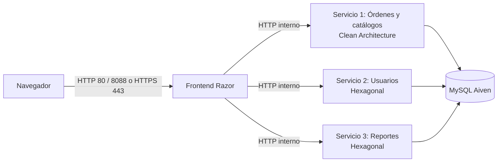

# Arquitectura SBA y despliegue de cuatro aplicaciones

La solución integra un Frontend Razor y tres APIs ASP.NET Core .NET 10. Cada
aplicación tiene su proyecto, proceso e imagen Docker; todas comparten solamente
los DTO de `shared/TallerMecanico.Contratos` y las tres APIs usan la misma base
MySQL de Aiven.

## Responsabilidades y límites

- **Frontend:** páginas, cookies, sesión y borradores en memoria. Consume los
  clientes de `Api/`; no recibe la cadena MySQL ni las credenciales del correo.
- **Órdenes:** catálogos, dashboard, consultas y transacciones de órdenes. Es el
  único servicio que crea o actualiza el esquema al arrancar.
- **Usuarios:** credenciales, estado de cuentas, invitaciones, activación, cambio
  de contraseña, correo y auditoría de acceso. Aloja los comandos de consola.
- **Reportes:** consultas agregadas, filtros, gráficos y exportaciones PDF/XLSX.
- **Contratos:** datos de solicitud y respuesta compartidos entre las apps.

Órdenes usa Clean Architecture; Usuarios y Reportes usan puertos y adaptadores.
Sus guías detalladas son [Clean](ARQUITECTURA_CLEAN.md) y
[Hexagonal](ARQUITECTURA_HEXAGONAL.md).

## Comunicación y autorización

El Frontend agrega `X-Clave-Interna` y, cuando hay sesión, `X-Usuario-Id`,
`X-Usuario-Nombre` y `X-Usuario-Rol`. Las APIs validan la clave y repiten la
autorización por rol. `CLAVE_INTERNA` se configura en `.env` y se entrega mediante
variables de entorno, nunca se incluye en las imágenes.

La red de Compose publica únicamente el Frontend. Las APIs escuchan en 8080 y
solo declaran `expose`; el navegador no llama directamente a ellas. El tráfico
interno usa HTTP. HTTPS entre Frontend y APIs es una mejora pendiente.

## Docker y orden de arranque

| Servicio Compose | Proyecto | Puertos hacia la PC |
|---|---|---|
| `frontend` | `frontend-app/TallerMecanico.Frontend.csproj` | 80 y 8088 hacia HTTP 8080; 443 hacia HTTPS 8443 |
| `servicio-ordenes` | `backend-services/servicio-ordenes/TallerMecanico.ServicioOrdenes.csproj` | Ninguno |
| `servicio-usuarios` | `backend-services/servicio-usuarios/TallerMecanico.ServicioUsuarios.csproj` | Ninguno |
| `servicio-reportes` | `backend-services/servicio-reportes/TallerMecanico.ServicioReportes.csproj` | Ninguno |

Cada imagen se construye desde la raíz del repositorio e incluye el proyecto
compartido. Los healthchecks usan `curl http://localhost:8080/salud`.

1. Órdenes prepara el esquema y empieza a responder `/salud`.
2. Usuarios y Reportes esperan a que Órdenes esté sano.
3. El Frontend espera a que estén sanas las tres APIs.
4. `NubeUp` espera las cuatro y comprueba el acceso HTTP desde la PC.

`/salud` confirma que el proceso atiende solicitudes. En Órdenes también implica
que terminó la inicialización inicial del esquema; no es una consulta periódica
a MySQL ni una prueba de todos los flujos del negocio.

Kestrel usa `certs/localhost.pem` y `certs/localhost-key.pem`, montados como solo
lectura en `/https`. La sesión vive en una única instancia del Frontend; sus
claves de Data Protection se conservan en el volumen `taller-dpkeys`.

## Verificación de la integración

Los comandos de preparación y ejecución están en [README](../README.md). La
existencia de proyectos y healthchecks no demuestra por sí sola todos los
requisitos. La defensa debe incluir login por rol, invitación y activación,
cambio de contraseña, CRUD y auditoría, transacción/anulación de órdenes y ambos
reportes en PDF y Excel.

El despliegue se verifica con `dotnet msbuild -t:NubeUp`, `NubeStatus` y los
recorridos anteriores; las pruebas automatizadas se ejecutan por aplicación sobre
MySQL temporal. Registrar por separado la fecha, los comandos y los resultados
reales. No reutilizar como evidencia del SBA las pruebas históricas de réplicas.
